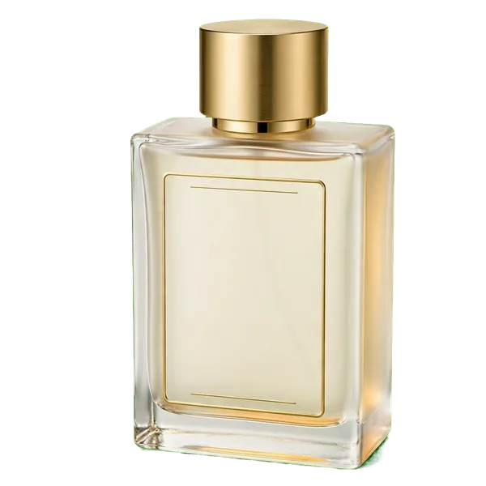
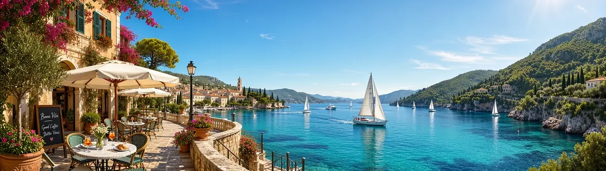

# MAI Image 2.7 API: cURL, Python, and Node.js Examples

[](https://poyo.ai/models/mai-image-2-7?utm_source=github&utm_medium=readme&utm_campaign=mai-image-2-7-api) [](https://docs.poyo.ai/api-manual/image-series/mai-image-2-7?utm_source=github&utm_medium=readme&utm_campaign=mai-image-2-7-api) [](https://github.com/PoyoAPI/MAI-Image-2.7-API/actions/workflows/check.yml)

Runnable examples for Microsoft **MAI Image 2.7** and **MAI Image 2.7 Flash** through PoYo's async image API: text-to-image, precise edits, and composition of up to 5 reference images, with 1K or 2K output, custom sizes up to 4,194,304 pixels, transparent backgrounds, and PNG, JPEG, or WebP files.

**Answer:** To use the MAI Image 2.7 API, send a server-side request to `POST https://api.poyo.ai/api/generate/submit` with model `mai-image-2.7` (or `mai-image-2.7-flash`) and a PoYo API key, then poll `GET https://api.poyo.ai/api/generate/status/{task_id}`. Add `image_urls` to the same request to edit or combine images. The examples in this repository run with Python 3.9+, Node.js 22+, or cURL.

Last verified against the PoYo schema and pricing on **November 19, 2026**.

## MAI Image 2.7 API at a glance

- **Model IDs:** `mai-image-2.7` and `mai-image-2.7-flash` on `POST https://api.poyo.ai/api/generate/submit`
- **Developer:** Microsoft AI (MAI), Microsoft's in-house model team
- **Released:** previewed for editing on October 27, 2026; MAI Image 2.7 and MAI Image 2.7 Flash released on November 17, 2026; live on PoYo since November 19, 2026
- **Tasks:** text-to-image, single-image editing, and composition of 1–5 JPEG, PNG, or WebP reference images, all on the same model ID
- **Output:** one PNG, JPEG, or WebP image per request; `1K` is about 1 megapixel (1:1 is 1024×1024) and `2K` about 4 megapixels (16:9 is 2720×1536)
- **Sizes:** 1:1, 4:3, 3:4, 3:2, 2:3, 16:9, 9:16, or a custom `WIDTHxHEIGHT`; the largest output is 4,194,304 pixels, such as 2048×2048 or 3840×1088
- **Prompt:** up to 32,000 characters
- **Transparent background:** `background: "transparent"` with PNG or WebP output
- **Price:** billed by tokens, pay-as-you-go; a 1K square image costs about 5.58 credits ($0.028) on MAI Image 2.7 and 1.64 credits ($0.0082) on Flash
- **Speed:** in PoYo tests in November 2026, most MAI Image 2.7 tasks finished in about 35–70 seconds and Flash tasks in about 25–50 seconds
- **Access:** a hosted Microsoft model used through an API; call it from Python, Node.js, cURL, or the PoYo MCP tools

## MAI Image 2.7 API examples (images)

Real MAI Image 2.7 and MAI Image 2.7 Flash outputs generated through PoYo on November 18, 2026. Each preview is a downscaled WebP; click it to open the full-size file. The credits are the amounts charged for each task.

<table>
<tr>
<td align="center" valign="top"><a href="https://storage.poyo.ai/models/mai-image-2-7/examples/default-lamp-571bef49eef4.png"></a><br><b>Text-to-image · 3:2 · 1K · 1152×768 · 4.74 credits</b><br><sub>The output of <code>payloads/mai-image-2.7-text-to-image.json</code></sub></td>
<td align="center" valign="top"><a href="https://storage.poyo.ai/models/mai-image-2-7/examples/chalkboard-text-edit-66baecdbfb24.png"></a><br><b>Text edit · 1 reference · 880×1184 · 6.56 credits</b><br><sub>"MORNING BLEND" rewritten to "AUTUMN SPICE" (<code>payloads/mai-image-2.7-image-edit.json</code>)</sub></td>
</tr>
<tr>
<td align="center" valign="top"><a href="https://storage.poyo.ai/models/mai-image-2-7/examples/perfume-transparent-b62c2b1516ed.png"></a><br><b>Transparent PNG · 1:1 · 1K · 1024×1024 · 5.60 credits</b><br><sub>The output of <code>payloads/mai-image-2.7-transparent-background.json</code></sub></td>
<td align="center" valign="top"><a href="https://storage.poyo.ai/models/mai-image-2-7/examples/compose-sneaker-pier-b3304c9c7c97.png"></a><br><b>4 reference images · 16:9 · 1K · 1360×768 · 10.85 credits</b><br><sub>Sneaker, boards, swatch, and pier combined (<code>payloads/mai-image-2.7-multi-reference.json</code>)</sub></td>
</tr>
<tr>
<td align="center" valign="top"><a href="https://storage.poyo.ai/models/mai-image-2-7/examples/flash-pier-cb5f548d4681.png"></a><br><b>Flash text-to-image · 1:1 · 1K · 1024×1024 · 1.64 credits</b><br><sub>The output of <code>payloads/mai-image-2.7-flash-text-to-image.json</code></sub></td>
<td align="center" valign="top"><a href="https://storage.poyo.ai/models/mai-image-2-7/features/custom-size-109bb6d78887.webp"></a><br><b>Custom size · 3840×1088 · 22.24 credits</b><br><sub>Full-width website banner (<code>payloads/mai-image-2.7-custom-size.json</code>)</sub></td>
</tr>
</table>

The chalkboard source image was also generated with MAI Image 2.7, and the four composition references were generated with MAI Image 2.7 Flash.

<details>
<summary>Prompt: table lamp (text-to-image, 3:2, 1K)</summary>

```text
Product photo of a mint-green ceramic table lamp with a linen shade on a walnut side table, next to a stack of two books and a small succulent in a white pot, plain off-white wall, soft daylight from the left.
```

</details>

<details>
<summary>Prompt: chalkboard text edit (1 reference image)</summary>

```text
Change the headline from "MORNING BLEND" to "AUTUMN SPICE" and the line below to "Pumpkin Latte · Today Only". Keep the chalk lettering style, board texture, perspective, lighting and background unchanged.
```

</details>

<details>
<summary>Prompt: perfume bottle (transparent PNG, 1:1, 1K)</summary>

```text
A frosted glass perfume bottle with a brushed gold cap, front three-quarter view, studio product shot with soft reflections, product only.
```

</details>

<details>
<summary>Prompt: sneaker campaign (4 reference images, 16:9, 1K)</summary>

```text
Create a campaign hero image: the sneaker from image 1 resting on the blue wooden boards from image 2, placed on the pier from image 4 at golden hour, with a color palette taken from image 3. Keep the sneaker's shape, canvas material and gum sole exactly as in image 1.
```

</details>

<details>
<summary>Prompt: seaside pier (Flash, 1:1, 1K)</summary>

```text
An empty Mediterranean seaside pier at golden hour, wide shot.
```

</details>

<details>
<summary>Prompt: panoramic banner (custom size 3840x1088)</summary>

```text
A panoramic website hero banner: a calm turquoise bay with white sailboats, a curved stone promenade with cafe umbrellas on the left, rolling green hills on the right, bright midday light, wide cinematic composition with open sky for a headline.
```

</details>

## What is MAI Image 2.7?

MAI Image is Microsoft AI's in-house family of image models, and MAI Image 2.7 is its newest image generation and editing model, released together with the faster MAI Image 2.7 Flash on November 17, 2026. According to Microsoft's model card, it is a 20-billion-parameter diffusion model built for precise edits that keep the rest of the image intact, in-image text, photorealistic images, and transparent product assets. According to Microsoft, the October 27, 2026 editing preview debuted above GPT Image 2.5 Flare on Artificial Analysis and at #3 on Arena.

One model ID covers both text-to-image and editing: a request with only a prompt generates a new image, and adding `image_urls` edits or combines the supplied images. This makes MAI Image 2.7 a Microsoft image generation API and image editing API behind a single request format.

### MAI Image 2.7 vs MAI Image 2.7 Flash vs MAI Image 2.6

| | MAI Image 2.7 | MAI Image 2.7 Flash | MAI Image 2.6 |
| --- | --- | --- | --- |
| Model ID | `mai-image-2.7` | `mai-image-2.7-flash` | `mai-image-2.6` |
| Best for | Final assets, precise edits, in-image text | Drafts, previews, high-volume jobs | Final campaign assets with optional web search |
| Reference images | Up to 5 | Up to 5 | Up to 5 |
| 2K output at 16:9 | 2720×1536 | 2720×1536 | 2048×1152 |
| Custom size | Multiples of 16, up to 4,194,304 pixels | Multiples of 16, up to 4,194,304 pixels | Multiples of 32, up to 2,359,296 pixels |
| Background | Opaque or transparent (PNG, WebP) | Opaque or transparent (PNG, WebP) | Opaque |
| Output format | PNG, JPEG, WebP | PNG, JPEG, WebP | PNG |
| Credits per 1M tokens (text / image input / output) | 800 / 1,280 / 5,440 | 280 / 400 / 1,600 | 800 / 1,280 / 6,080 |
| 1K square image | About 5.58 credits | About 1.64 credits | About 6.23 credits |
| Typical time in PoYo tests | About 35–70 s | About 25–50 s | About 15–50 s |

Both MAI Image 2.7 model IDs take exactly the same request fields, so you can draft on Flash and render the final image on MAI Image 2.7 by changing only `model`. According to Microsoft, MAI Image 2.7 improves on MAI Image 2.6 in all 10 use cases and all 7 editing actions evaluated by Artificial Analysis. PoYo offers four MAI Image API models with one key: `mai-image-2.7`, `mai-image-2.7-flash`, `mai-image-2.6`, and `mai-image-2.6-flash`. MAI Image 2.6 is documented on its [model page](https://poyo.ai/models/mai-image-2-6?utm_source=github&utm_medium=readme&utm_campaign=mai-image-2-7-api).

## MAI Image 2.7 API quickstart

1. Create a key in the [PoYo dashboard](https://poyo.ai/dashboard/api-key?utm_source=github&utm_medium=readme&utm_campaign=mai-image-2-7-api).
2. Copy `.env.example` to `.env` and replace the placeholder.
3. Run one of the examples. Each submits the task, polls until `finished` or `failed`, and prints the image URL.

```dotenv
POYO_API_KEY=YOUR_POYO_API_KEY_HERE
POYO_BASE_URL=https://api.poyo.ai
```

### Python

```bash
python python/generate.py
python python/generate.py payloads/mai-image-2.7-image-edit.json
```

[`python/generate.py`](python/generate.py) uses only the Python standard library. The core of a MAI Image 2.7 API call in Python is a submit followed by status polling:

```python
import json, os, time, urllib.request

API = "https://api.poyo.ai"
HEADERS = {
    "Authorization": f"Bearer {os.environ['POYO_API_KEY']}",
    "Content-Type": "application/json",
    "User-Agent": "mai-image-2-7-example/1.0",
}

def call(path, body=None):
    data = json.dumps(body).encode() if body else None
    request = urllib.request.Request(API + path, data=data, headers=HEADERS, method="POST" if data else "GET")
    with urllib.request.urlopen(request, timeout=60) as response:
        return json.load(response)

task = call("/api/generate/submit", {
    "model": "mai-image-2.7",
    "input": {"prompt": "A ceramic table lamp on a walnut side table, soft daylight", "size": "3:2"},
})
task_id = task["data"]["task_id"]
while (status := call(f"/api/generate/status/{task_id}")["data"])["status"] not in ("finished", "failed"):
    time.sleep(5)
print(status["files"][0]["file_url"] if status["status"] == "finished" else status["error_message"])
```

Add `"image_urls": [...]` to `input` to edit, or change `model` to `mai-image-2.7-flash`. The full script also checks the `code` field and reads `.env`.

### Node.js

```bash
node node/index.mjs
node node/index.mjs payloads/mai-image-2.7-flash-text-to-image.json
```

### cURL

```bash
curl -X POST "https://api.poyo.ai/api/generate/submit" \
  -H "Authorization: Bearer $POYO_API_KEY" \
  -H "Content-Type: application/json" \
  -d '{
  "model": "mai-image-2.7",
  "input": {
    "prompt": "Product photo of a mint-green ceramic table lamp with a linen shade on a walnut side table, next to a stack of two books and a small succulent in a white pot, plain off-white wall, soft daylight from the left.",
    "size": "3:2",
    "resolution": "1K"
  }
}'
```

Status polling and the other modes are in [curl/generate.md](curl/generate.md).

## Example requests

Every file in [`payloads/`](payloads) is a complete request body with public reference images, so it runs as-is. The credits are the amounts charged when these exact requests ran on November 18, 2026.

| File | Model | Mode | Settings | Credits |
| --- | --- | --- | --- | --- |
| [`mai-image-2.7-text-to-image.json`](payloads/mai-image-2.7-text-to-image.json) | `mai-image-2.7` | Text-to-image | 3:2, 1K | 4.74 ($0.024) |
| [`mai-image-2.7-image-edit.json`](payloads/mai-image-2.7-image-edit.json) | `mai-image-2.7` | Edit one image | 1 reference, follows its 3:4 shape | 6.56 ($0.033) |
| [`mai-image-2.7-transparent-background.json`](payloads/mai-image-2.7-transparent-background.json) | `mai-image-2.7` | Transparent PNG | 1:1, 1K | 5.60 ($0.028) |
| [`mai-image-2.7-multi-reference.json`](payloads/mai-image-2.7-multi-reference.json) | `mai-image-2.7` | Combine images | 4 references, 16:9, 1K | 10.85 ($0.054) |
| [`mai-image-2.7-custom-size.json`](payloads/mai-image-2.7-custom-size.json) | `mai-image-2.7` | Custom size | 3840x1088 | 22.24 ($0.111) |
| [`mai-image-2.7-flash-text-to-image.json`](payloads/mai-image-2.7-flash-text-to-image.json) | `mai-image-2.7-flash` | Text-to-image | 1:1, 1K | 1.64 ($0.0082) |

## Input modes

The supplied images select the mode automatically on both model IDs.

| Mode | Selected when | Output size |
| --- | --- | --- |
| Text-to-image | `image_urls` is omitted | From `size` and `resolution` (default 1:1 at 1K) |
| Edit one image | `image_urls` has 1 URL | Follows the reference image's aspect ratio at about 1 megapixel, or `size` when set |
| Combine images | `image_urls` has 2–5 URLs | Follows the first reference image's aspect ratio at about 1 megapixel, or `size` when set |

Reference images are used at up to about 1 megapixel. Refer to them in the prompt by order as image 1 to image 5.

## Writing MAI Image 2.7 prompts

- **Quote exact text:** put on-image wording in quotes. For text edits, quote both the current and the new wording, for example `Change the headline from "MORNING BLEND" to "AUTUMN SPICE"`.
- **Say what stays:** end an edit with what to keep, such as "Keep the table, books, wall, lighting and camera framing exactly the same", and make one change per request.
- **Give each reference a role:** name inputs by order, for example "the sneaker from image 1 on the boards from image 2, with the palette of image 3".
- **Transparent assets:** describe the subject alone ("product only", "clean edges"), then set `background` to `transparent` with `output_format` `png` or `webp`.
- **Draft on Flash, finish on 2.7:** iterate with `mai-image-2.7-flash`, then switch `model` to `mai-image-2.7` for the final render, or raise `resolution` to `2K`.

More prompt examples are in the [MAI Image 2.7 API reference](https://docs.poyo.ai/api-manual/image-series/mai-image-2-7?utm_source=github&utm_medium=readme&utm_campaign=mai-image-2-7-api).

## Request fields

Top-level fields are `model`, `input`, and an optional `callback_url`. Fields inside `input`:

| Field | Requirement | Meaning |
| --- | --- | --- |
| prompt | required | Image description or edit instruction, 1–32,000 characters. Put exact on-image text in quotes. |
| image_urls | optional | Array of 1–5 public HTTP(S) URLs in JPEG, PNG, or WebP. One image is edited; several are combined. |
| size | optional | `1:1`, `4:3`, `3:4`, `3:2`, `2:3`, `16:9`, `9:16`, or `WIDTHxHEIGHT`. Text-to-image default `1:1`. |
| resolution | optional | `1K` (default, about 1 megapixel) or `2K` (about 4 megapixels). Applies to aspect-ratio sizes. |
| background | optional | `opaque` (default) or `transparent`. Transparent output uses `output_format` `png` or `webp`. |
| output_format | optional | `png` (default), `jpeg`, or `webp`. |

Custom `WIDTHxHEIGHT` sizes use both sides divisible by 16, each side at least 768, and at most 4,194,304 pixels in total, such as `2048x2048`, `3072x1344`, or `3840x1088`. They are used exactly as given. Each request returns one image; send parallel requests for variations.

## MAI Image 2.7 API pricing

On PoYo, a 1K square image costs about $0.028 (5.58 credits) with MAI Image 2.7 and about $0.0082 (1.64 credits) with MAI Image 2.7 Flash; a 2K image costs about $0.111 and $0.033. Billing is by tokens, pay-as-you-go, with no subscription. 1 credit = $0.005.

| Model | Text input | Reference image input | Image output |
| --- | --- | --- | --- |
| `mai-image-2.7` | 800 credits ($4.00) per 1M tokens | 1,280 credits ($6.40) per 1M tokens | 5,440 credits ($27.20) per 1M tokens |
| `mai-image-2.7-flash` | 280 credits ($1.40) per 1M tokens | 400 credits ($2.00) per 1M tokens | 1,600 credits ($8.00) per 1M tokens |

- Output tokens = output width × height / 1024. A 1024×1024 image is 1,024 tokens; 2720×1536 is 4,080 tokens.
- Each reference image adds its sent width × height / 1024 tokens, up to 1,024 tokens per image.
- Text tokens = UTF-8 bytes of the prompt / 4, rounded up.

A maximum based on size, prompt length, and reference images is reserved at submission. When the task finishes, the charge is set by the actual tokens and never exceeds that reserve. Confirm current prices on the [model page](https://poyo.ai/models/mai-image-2-7?utm_source=github&utm_medium=readme&utm_campaign=mai-image-2-7-api) before a production rollout.

### Cost per image

| Output | `mai-image-2.7` | `mai-image-2.7-flash` |
| --- | --- | --- |
| 1K, 1:1 (1024×1024) | 5.58 credits ($0.028) | 1.64 credits ($0.0082) |
| 2K, 16:9 (2720×1536) | 22.20 credits ($0.111) | 6.53 credits ($0.033) |
| 2K, 1:1 (2048×2048) | about 22.3 credits ($0.112) | about 6.56 credits ($0.033) |
| Edit with 1 reference, about 1 megapixel | 6.89 credits ($0.034) | about 2.05 credits ($0.010) |
| 1,000 images at 1K, 1:1 | about 5,580 credits ($27.90) | about 1,640 credits ($8.20) |

Values without "about" were charged on real PoYo tasks in November 2026 (Flash 2K measured at 9:16, which has the same pixel count); the others are calculated from the token rates with a short prompt. Failed generation tasks are not charged credits.

## Async production flow

```text
submit -> persist data.task_id -> poll during development -> receive callback_url webhook in production
```

Treat `finished` and `failed` as terminal states. The finished image is in `data.files[0].file_url`. Accept a webhook only for task IDs your system created, process it idempotently, and reconcile the final state through the status endpoint. Copy output images to your own storage after the task finishes.

## Common errors

Always read `code` in the response body: parameter errors return HTTP 200 with `code: 400`. The messages below are the exact responses from PoYo test runs.

| `code` | `error.type` | Example message and fix |
| --- | --- | --- |
| 400 | `validation_error` | `background transparent requires output_format png or webp`: set `output_format` to `png` or `webp`. |
| 400 | `validation_error` | `Invalid custom size. Use WIDTHxHEIGHT with both sides divisible by 16, each side at least 768, and total pixels at most 4194304 (for example 2048x2048 or 3072x1344)`: for example, send `1008x800` instead of `1000x800`. |
| 400 | `validation_error` | `Too many image_urls. Maximum allowed is 5, but got 6`: send up to 5 reference images per request. |
| 400 | `validation_error` | `prompt must be less than or equal to 32000 characters`: shorten the prompt. |
| 400 | `content_moderation_error` | The prompt or image was declined by safety review: revise and submit a new task. |
| 401 | `authentication_error` | Missing or invalid key: send `Authorization: Bearer <POYO_API_KEY>`. |
| 402 | `insufficient_credits_error` | Top up credits in the [dashboard](https://poyo.ai/dashboard?utm_source=github&utm_medium=readme&utm_campaign=mai-image-2-7-api). |
| 429 | `rate_limit_error` | Back off and retry. |

A task that fails after submission returns `status: "failed"` with `error_message`, and is not charged credits. In PoYo tests, a reference URL that could not be downloaded ended with `Server exception, please try again later or contact customer service`; make sure every URL in `image_urls` opens publicly without login. See [error codes](https://docs.poyo.ai/api-manual/error-codes?utm_source=github&utm_medium=readme&utm_campaign=mai-image-2-7-api).

## MAI Image 2.7 API FAQ

**What is MAI Image 2.7?** MAI Image is Microsoft AI's family of image models. MAI Image 2.7 is the image generation and editing model released with the faster MAI Image 2.7 Flash on November 17, 2026. PoYo offers both through one REST API as `mai-image-2.7` and `mai-image-2.7-flash`.

**Can MAI Image 2.7 generate new images, or does it only edit?** It does both. Microsoft's October 27, 2026 preview started with editing, and the November 17 release added text-to-image to the same model. On PoYo, a prompt-only request generates a new image, and adding 1 to 5 images in `image_urls` turns the same request into an edit or a composition.

**How do I use the MAI Image 2.7 API in Python?** Create a PoYo API key, send `POST https://api.poyo.ai/api/generate/submit` with `"model": "mai-image-2.7"` and an `input` object with a `prompt`, then poll `GET /api/generate/status/{task_id}` until `finished` and read `data.files[0].file_url`. The [Python quickstart](#python) above shows the whole flow in about 20 lines of standard-library code, and the same JSON works from Node.js and cURL.

**How much does the MAI Image 2.7 API cost?** `mai-image-2.7` costs 800, 1,280, and 5,440 credits per 1M text input, reference image, and output tokens; `mai-image-2.7-flash` costs 280, 400, and 1,600. A 1K square image is about 5.58 credits ($0.028) on MAI Image 2.7 and 1.64 credits ($0.0082) on Flash; a 2K square image is about 22.3 and 6.56 credits. Failed tasks are free.

**Is MAI Image 2.7 free to use?** It is pay-as-you-go on PoYo, with no subscription or minimum spend, and you pay only for finished images. You can try both models in the [Playground](https://poyo.ai/models/mai-image-2-7?utm_source=github&utm_medium=readme&utm_campaign=mai-image-2-7-api) before integrating the API. MAI Image 2.7 Flash is the lowest-cost option, at about 1.64 credits ($0.0082) per 1K image.

**What is the difference between MAI Image 2.7 and MAI Image 2.7 Flash?** Flash is the optimized version for fast, cost-efficient generation. Both accept exactly the same fields: text-to-image, up to 5 reference images, 1K or 2K, custom sizes, transparent backgrounds, and PNG, JPEG, or WebP output. In PoYo tests Flash finished in about 25 to 50 seconds versus 35 to 70 for MAI Image 2.7.

**How is MAI Image 2.7 different from MAI Image 2.6?** On PoYo, MAI Image 2.7 adds transparent backgrounds, JPEG and WebP output, 2K at 2720×1536 for 16:9, and custom sizes up to 4,194,304 pixels, at a lower output rate of 5,440 credits per 1M tokens. Switching from the MAI Image 2.6 API starts with the model ID.

**Should I use MAI Image 2.7 or GPT Image 2.6?** Both run on PoYo with the same API key, so you can send the same prompt to each and compare. MAI Image 2.7 suits precise edits that keep the rest of an image intact, in-image text updates, and transparent PNG or WebP assets. GPT Image 2.6 offers Flare and Sunburst versions, 4K output, and up to 16 reference images; see [GPT-Image-2.6-API](https://github.com/PoyoAPI/GPT-Image-2.6-API).

**Can the MAI Image 2.7 API create images with a transparent background?** Yes. Set `background` to `transparent` and `output_format` to `png` or `webp` on either model ID, and the image comes back with an alpha channel, ready for product listings, logos, and icons.

**What sizes and maximum resolution does the MAI Image 2.7 API support?** Seven aspect ratios at `1K` (1024×1024 for 1:1) or `2K` (2048×2048 for 1:1, 2720×1536 for 16:9), or a custom `WIDTHxHEIGHT` with both sides divisible by 16 and each side at least 768. The largest output is 4,194,304 pixels, such as `2048x2048`, `3072x1344`, or `3840x1088`.

**Can MAI Image 2.7 edit text inside an image?** Yes. Quote the current and the new wording and say what to keep, as in the chalkboard example above, where "MORNING BLEND" became "AUTUMN SPICE" in matching chalk lettering. Microsoft lists text updates among MAI Image 2.7's editing actions. Check spelling and small print before you publish.

**How many reference images can I send?** Up to 5 public JPEG, PNG, or WebP URLs in `image_urls`. One image is edited, several are combined, and the prompt can refer to them as image 1 to image 5.

**How long does a generation take?** In PoYo tests in November 2026, MAI Image 2.7 finished most tasks in about 35 to 70 seconds and Flash in about 25 to 50 seconds, depending on size, reference images, and load. Submitting returns a `task_id` immediately; poll the status endpoint or pass a `callback_url`.

**Is MAI Image 2.7 open source, or can I download it?** Microsoft offers MAI Image 2.7 as a hosted model through Microsoft Foundry, MAI Labs, and API partners, so you use it by calling an API such as PoYo's. Every image you create is a downloadable PNG, JPEG, or WebP file at `data.files[0].file_url`.

**Can I use it from an AI agent?** Yes. The [PoYo MCP bridge](https://github.com/PoyoAPI/poyo-devtools) exposes the models as the `poyo_mai_image_2_7` and `poyo_mai_image_2_7_flash` tools.

## Repository map

- [`payloads/`](payloads) — complete request bodies for each mode
- [`python/generate.py`](python/generate.py) — standard-library Python example
- [`node/index.mjs`](node/index.mjs) — dependency-free Node.js example
- [`curl/generate.md`](curl/generate.md) — copy-paste cURL requests
- [`docs/production-notes.md`](docs/production-notes.md) — limits, billing, and rollout checklist
- [`assets/`](assets) — gallery previews of real outputs

## Related repositories

- [GPT-Image-2.6-API](https://github.com/PoyoAPI/GPT-Image-2.6-API) — GPT Image 2.6 text-to-image and image-to-image examples
- [MiniMax-H3-Image-API](https://github.com/PoyoAPI/MiniMax-H3-Image-API) — MiniMax H3 Image examples
- [Seedream-5.5-API](https://github.com/PoyoAPI/Seedream-5.5-API) — Seedream 5.5 image examples
- [poyo-examples](https://github.com/PoyoAPI/poyo-examples) — examples across PoYo models
- [poyo-devtools](https://github.com/PoyoAPI/poyo-devtools) — PoYo CLI, MCP bridge, and Agent Skill (MCP tools `poyo_mai_image_2_7`, `poyo_mai_image_2_7_flash`)

## Links

- [MAI Image 2.7 API on PoYo](https://poyo.ai/models/mai-image-2-7?utm_source=github&utm_medium=readme&utm_campaign=mai-image-2-7-api)
- [MAI Image 2.7 API reference](https://docs.poyo.ai/api-manual/image-series/mai-image-2-7?utm_source=github&utm_medium=readme&utm_campaign=mai-image-2-7-api)
- [MAI Image 2.7 Flash API reference](https://docs.poyo.ai/api-manual/image-series/mai-image-2-7-flash?utm_source=github&utm_medium=readme&utm_campaign=mai-image-2-7-api)
- [MAI Image 2.6 API on PoYo](https://poyo.ai/models/mai-image-2-6?utm_source=github&utm_medium=readme&utm_campaign=mai-image-2-7-api)
- [PoYo model catalog](https://poyo.ai/models?utm_source=github&utm_medium=readme&utm_campaign=mai-image-2-7-api)

## License

MIT
